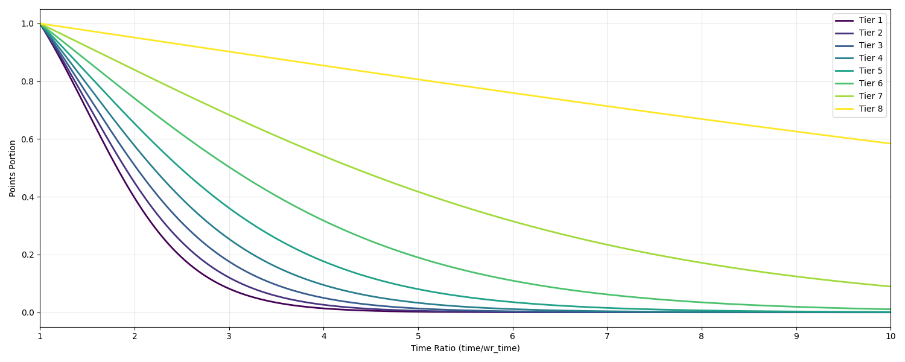

# CS2KZ Ranking System

<details>
<summary><h2 style="display:inline-block">Terminology</h2></summary>

A KZ map can have one or multiple **courses**.
Each course has its own start and end timer zone, and the player must traverse from the start to the end to finish.

Each course has two **filters**, one for CKZ and one for VNL. A filter stores mode-specific information:

* **Tier** → Difficulty with checkpoints and teleports allowed.
* **Pro Tier** → Difficulty without any plugin teleports.
* **State** → Whether the course is `unranked`, `pending`, or `ranked`. Only ranked filters contribute to player rating.

Each filter has two leaderboards:

* **Overall leaderboard** → Teleports allowed.
* **Pro leaderboard** → No teleports.

Runs on **globally approved maps** are saved worldwide. Only those maps can have ranked filters.
Runs on courses with unranked filter still get course points, but they do **not** contribute to player rating. Runs with **styles enabled** will **not** provide course points.

</details>


<details>
<summary><h2 style="display:inline-block">Ranks</h2></summary>

CS2KZ uses two systems in tandem to measure the player's skill and performance:

1. **Course points** → How good your run is compared to others on a given course.
2. **Player rating** → Your overall performance, based on ranked course points.

Similar to filters, both are **mode-specific**.

<details>
<summary><h3 style="display:inline-block">Course point</h3></summary>

When you beat your PB (or finish for the first time), you earn up to **10,000 points** using:


```
Points = MinPoints + (10000 - MinPoints) * (0.125 * RankPointsPortion + 0.875 * DistPointsPortion)
```

* **MinPoints** ensures harder courses are accurately rewarded.
* **RankPointsPortion** rewards leaderboard placement on highly competitive courses.
* **DistPointsPortion** rewards how close your time is to the best runs.

The values are designed so that as a general rule of thumb, every 100 points you earn move you up one percentile point relative to the whole player base.

---

<details>
<summary><strong>MinPoints</strong></summary>

The baseline reward for finishing a course. Harder tiers give higher minimums. Pro runs give more reward.

| Tier | MinPoints | MinPoints (PRO) |
|------|-----------|-----------------|
| 1    | 0         | 1000            |
| 2    | 500       | 1450            |
| 3    | 2000      | 2800            |
| 4    | 3500      | 4150            |
| 5    | 5000      | 5500            |
| 6    | 6500      | 6850            |
| 7    | 8000      | 8200            |
| 8    | 9500      | 9550            |

Its purpose is to better reflect the player's skill compared to the rest of the player base on higher difficulty maps.

Someone finishing a Tier 8 course, even last place, is still likely better than 95% of the player base. This scaling makes sure higher tiers reflect that skill.

</details>

<details>
<summary><strong>RankPointsPortion</strong></summary>

A **multiplier between 0.0 and 1.0** based on your rank position starting from **top 100**.

* **Top 100** → +0.004 per rank above #100.
* **Top 20** → Additional +0.02 per rank above #20.
* **Top 5** → Extra fixed bonuses.

| Rank | Bonus |
| ---- | ----- |
| 5    | +0.02 |
| 4    | +0.06 |
| 3    | +0.09 |
| 2    | +0.12 |
| 1    | +0.20 |

This reflects the steep difficulty curve at the very top, espeically useful on highly optimized courses where point based on the time distribution alone is insufficient to reflect the skill gap.

Example: A difference of 0.1s on a highly popular and optimized course might be extremely difficult to obtain, but without the rank portion, the difference in points will be negligable and will not reflect the skill requirement for such time save.

<details>
<summary>Example</summary>

| Rank | Multiplier |
|------|------------|
| 120  | **0.000** |
| 100  | 0.004 * 1 = **0.004** |
| 80   | 0.004 * 21 = **0.08** |
| 15   | 0.004 * 86 + 0.02 * 6 = **0.464** |
| 2    | 0.004 * 99 + 0.02 * 19 + 0.12 = **0.896** |
| 1    | 0.004 * 100 + 0.02 * 20 + 0.20 = **1** |

</details>

</details>

<details>
<summary><strong>DistPointsPortion</strong></summary>

This is a multiplier between **0.0** and **1.0** based on how good the run is compared to other runs in the leaderboard: 

Roughly speaking:

```
DistPointsPortion ≈ Rank / Total
```

* Faster than 75% of players → ≈ 0.75.
* Faster than 90% of players → ≈ 0.90.

<details>
<summary>Roughly?</summary>

Directly recalculating rank vs. total would be unstable and costly. For every new player finishing a course, the entire leaderboard will need to be recalculated. This gets computationally expensive very quickly. For lower amount of total completions, the value is unstable and can wildly fluctuate, which is also not desirable.

Instead, we use a **distribution-based estimate** (Normalized Inverse Gaussian / Normal-Wald) that tries to calculate its percentile based on that duration.

The parameters of the distribution is regularly updated to fit with the actual dataset. 

If there aren’t enough completions (<50), we fall back to this formula:
```
P(time, wr, tier) = 
	(1 + exp((2.1 - 0.25 * tier) * -0.5))
	-------------------------------------------------
	(1 + exp((2.1 - 0.25 * tier) * (time / wr - 1.5)))
```

* Centered at **1.5× world record time**.
* Higher tiers reduce the scaling factor, making the curve more gradual, so performance differences matter less on harder courses.
* The values are manually chosen so that the transition from this formula to the distribution values is as subtle as possible.



</details>

</details>

</details>

---
<details>


<summary><h3 style="display:inline-block">Player rating</h3></summary>

Your **overall skill rating** comes from your course points on **ranked** courses:

```
Rating = Sum(CoursePoints * 0.975^(n-1)) * 0.1
```

Where:

* `n` = the course’s position when points are sorted descending.
* The maximum rating that a player can obtain is 40000.

This weighting system prevents “cheesing” with a single WR run. Your best maps matter most, but you must keep improving to increase your rating meaningfully.*

</details>

</details>